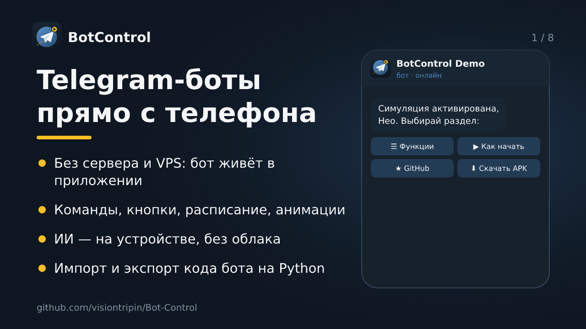

  

<h1 align="center">BotControl</h1>

<b>Telegram-боты прямо с телефона</b> — без сервера и VPS. 
Команды, кнопки, анимации, расписание, объявления, ИИ на устройстве и локальная версия для Windows / Linux / Termux.

  <a href="https://github.com/visiontripin/Bot-Control/releases/latest/download/BotControl-debug.apk"><b>⬇️ Скачать APK (Android)</b></a> ·
  <a href="https://github.com/visiontripin/Bot-Control/releases/download/botcontrol-windows-preview-0.6.0/BotControl.exe"><b>🖥 Скачать для Windows (.exe)</b></a> ·
  <a href="https://t.me/AppBotcontrol_bot"><b>🤖 Демо-бот @AppBotcontrol_bot</b></a> ·
  <a href="https://visiontripin.github.io/Bot-Control/presentation.html"><b>📊 Презентация</b></a> ·
  <a href="https://visiontripin.github.io/Bot-Control/"><b>🌐 Страница проекта</b></a>

## Как это работает

Обычному Telegram-боту нужен компьютер, который никогда не выключается:
аренда VPS, настройка окружения, автозапуск и туннели. **BotControl**
убирает сервер: бот живёт в Android-приложении на вашем телефоне (а для
тестов и настольной работы есть локальный веб-редактор на Windows / Linux /
Termux).

- 🔐 токен от @BotFather хранится в зашифрованном хранилище Android
  Keystore и никогда не попадает в экспорт, журнал или git;
- 🧩 поведение настраивается кнопками в одном конструкторе: команда, фраза,
  регулярка или нажатие → текст (`HTML`/`MarkdownV2`), набор фраз (в т.ч. `ShuffleBag`),
  анимация, медиа/опрос, расписание (с jitter и разовыми датами), пошаговая анкета (FSM),
  JS-скрипт с памятью `db` или ИИ;
- 👥 встроенная база подписчиков (`user`/`vip`/`admin`), обязательная подписка
  на канал (`getChatMember`) и массовые рассылки;
- 🔄 включённые боты автоматически запускаются после перезагрузки
  телефона (`BootReceiver`) и поддерживают исключение из оптимизации батареи;
- 🧠 локальная LLM (MediaPipe / LiteRT-LM) работает на устройстве, без облака;
- 📥 готовый бот на Python (telebot / aiogram) импортируется как конфиг —
  код не исполняется, приложение разбирает его в настройки и умеет
  экспортировать обратно в рабочий `.py`.

## Начать за 3 шага

1. Скачать [BotControl-debug.apk](https://github.com/visiontripin/Bot-Control/releases/latest/download/BotControl-debug.apk)
   (или открыть [все релизы](https://github.com/visiontripin/Bot-Control/releases))
   и установить на Android.
2. Получить токен: @BotFather → `/newbot` → скопировать токен.
3. В приложении: «+ Добавить бота» → вставить токен → «▶ Запустить».

Для Windows не требуется Python: скачайте [`BotControl.exe`](https://github.com/visiontripin/Bot-Control/releases/download/botcontrol-windows-preview-0.6.0/BotControl.exe)
и откройте локальный веб-редактор в браузере ([подробнее о Windows/Termux](tg-bot-control/desktop-web/README.md)).

## Прямые ссылки на скачивание

| Файл | Назначение | Прямая ссылка |
|---|---|---|
| `BotControl-debug.apk` | Android-приложение (последний релиз) | [Скачать APK](https://github.com/visiontripin/Bot-Control/releases/latest/download/BotControl-debug.apk) |
| `BotControl.exe` | Локальный редактор и запуск для Windows (0.6.0) | [Скачать EXE](https://github.com/visiontripin/Bot-Control/releases/download/botcontrol-windows-preview-0.6.0/BotControl.exe) |
| `presentation.pdf` | Презентация проекта (PDF, 12 слайдов) | [Открыть PDF](https://github.com/visiontripin/Bot-Control/releases/latest/download/presentation.pdf) · [HTML-версия](https://visiontripin.github.io/Bot-Control/presentation.html) |
| `presentation-bot-ready.py` | Конфиг демо-бота @AppBotcontrol_bot | [Скачать](https://github.com/visiontripin/Bot-Control/releases/latest/download/presentation-bot-ready.py) |
| `smith-bot-ready.py` | Конфиг «Агент Смит / перекур» (ИИ, шутки, расписание) | [Скачать](https://github.com/visiontripin/Bot-Control/releases/latest/download/smith-bot-ready.py) |
| `daromvpl-channel-ready.py` | Конфиг бота канала «Даром в ПЛ» (объявления, дайджесты) | [Скачать](https://github.com/visiontripin/Bot-Control/releases/latest/download/daromvpl-channel-ready.py) |
| `avatar-640.png` | Аватар бота для @BotFather (`/setuserpic`) | [Скачать](https://github.com/visiontripin/Bot-Control/releases/latest/download/avatar-640.png) |

## Что в репозитории

| Путь | Что там |
|---|---|
| [`tg-bot-control/android/`](tg-bot-control/android/) | исходники Android-приложения (Kotlin + Jetpack Compose) |
| [`tg-bot-control/desktop-web/`](tg-bot-control/desktop-web/) | локальный веб-редактор и Telegram-рантайм для Windows / Linux / Termux |
| [`tg-bot-control/*-ready.py`](tg-bot-control/) | готовые конфиги ботов: Агент Смит, канал «Даром в ПЛ», бот-презентация |
| [`tg-bot-control/ПЕРЕДАЧА-КОНТЕКСТА.md`](tg-bot-control/ПЕРЕДАЧА-КОНТЕКСТА.md) | память проекта: состояние, грамматика импорта, требования, ловушки |
| [`tg-bot-control/RELEASE-NOTES.md`](tg-bot-control/RELEASE-NOTES.md) | заметки к релизам по версиям |
| [`tg-bot-control/ДОРОЖНАЯ-КАРТА-TELEGRAM.md`](tg-bot-control/ДОРОЖНАЯ-КАРТА-TELEGRAM.md) | 5-этапная дорожная карта развития Telegram Bot API и паритета (`v1.8.0`–`v2.2.0`) |
| [`tg-bot-control/Инструкция-код-бота.md`](tg-bot-control/Инструкция-код-бота.md) | грамматика импорта и написание конфигов ботов |
| [`tg-bot-control/Промт-создание-ботов.md`](tg-bot-control/Промт-создание-ботов.md) | готовый промт для генерации ботов нейросетью |
| [`tg-bot-control/ГАЙД-СОЗДАНИЕ-БОТА-LLM.md`](tg-bot-control/ГАЙД-СОЗДАНИЕ-БОТА-LLM.md) | полный гайд + интерактивный мастер-промт для создания ботов с любой LLM |
| [`tg-bot-control/РЕЦЕНЗИЯ-ТЕСТИРОВАНИЕ.md`](tg-bot-control/РЕЦЕНЗИЯ-ТЕСТИРОВАНИЕ.md) | протокол QA-тестирования Android и Windows-версий |
| [`tg-bot-control/СПИСОК-ИСПРАВЛЕНИЙ.md`](tg-bot-control/СПИСОК-ИСПРАВЛЕНИЙ.md) | полный список исправлений и дорожная карта улучшений |
| [`handoff/`](handoff/) | инструкции переноса контекста (`00-PROMPT`…`04-state`, прикладываются к релизам) |
| [`docs/`](docs/) | сайт проекта ([index.html](docs/index.html)), презентация ([presentation.html](docs/presentation.html), [presentation.pdf](docs/presentation.pdf)) и [matrix-links.html](docs/matrix-links.html) |
| [`task.txt`](task.txt) | исходник страницы-хаба «Matrix Links» (совпадает с `docs/matrix-links.html`) |
| [`tg-bot-control/branding/`](tg-bot-control/branding/) | исходный логотип `logo.svg`, аватар бота, слайды, генераторы ассетов |
| [`tg-bot-control/tools/`](tg-bot-control/tools/) | Kotlin-харнесс импортёра, фикстуры, CI-проверки изоляции ботов и утечки токенов |
| [`.github/workflows/`](.github/workflows/) | CI: сборка APK (`botcontrol-apk.yml`), `BotControl.exe` (`botcontrol-windows.yml`), ассеты релизов (`botcontrol-attach.yml`) |

## Сборка и доставка

Собрать Android APK локально в песочнице нельзя (закрыты Google Maven и
Maven Central), поэтому сборка идёт в GitHub Actions (`botcontrol-apk.yml` —
Android, `botcontrol-windows.yml` — Windows, `botcontrol-attach.yml` —
прикрепление конфигов и презентации). Локально для Android нужен JDK 17 и
Android SDK 35; для `desktop-web/` достаточно Python 3.9+.

- **Текущая версия кода Android (ветка разработки / CI-артефакт):**
  **v1.9.0 (versionCode 40)** (выполнены этапы 1 и 2 из
  [`ДОРОЖНАЯ-КАРТА-TELEGRAM.md`](tg-bot-control/ДОРОЖНАЯ-КАРТА-TELEGRAM.md);
  следующий versionCode — **41**).
- **Последний опубликованный GitHub Release (`main`):** **v1.7.5 (versionCode 38)**,
  тег `botcontrol-v1.7.5-code38`, sha256
  `d8698e3fa45936842b6e658bc9242041feae54fdc568e3881b21b6579bfb236d`.
- **Текущее превью Windows:** **0.6.0**, тег
  `botcontrol-windows-preview-0.6.0`, sha256
  `bcf3138b7d56c6f5dd26701d37423791fcd476c255641d9944814753d75085d3`.

## Безопасность

Живых токенов ботов в репозитории нет и быть не должно — перед каждой
сборкой в CI запускается проверка `tg-bot-control/tools/check-no-tokens.py`
и проверка изоляции ботов `tg-bot-control/tools/check-bot-isolation.py`.
В git лежит только `debug.keystore` для воспроизводимой подписи debug-APK.
Токен бота из давно удалённого архива `botcontrol-handoff.zip` остался в
истории git и должен быть отозван через @BotFather (`/revoke`).
